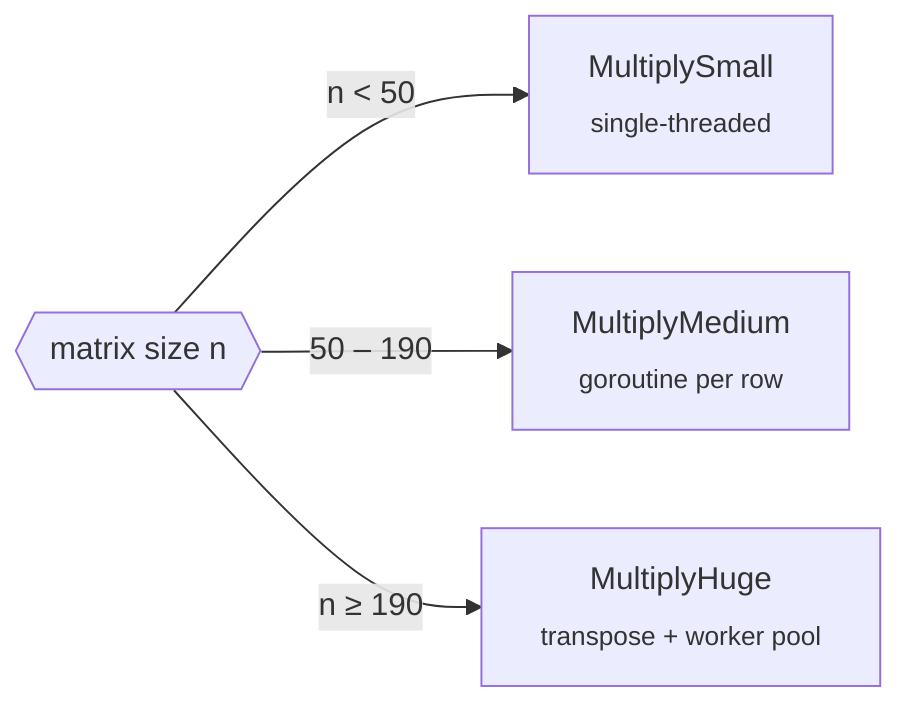

# gomatrices

[](https://pkg.go.dev/github.com/Quaximur/gomatrices)

Generic matrix multiplication in Go, with three strategies tuned for different sizes.

## Install

```bash
go get github.com/Quaximur/gomatrices
```

## Usage

```go
a := [][]float64{{1, 2}, {3, 4}}
b := [][]float64{{5, 6}, {7, 8}}

c, err := gomatrices.MultiplySmall(a, b) // [[19 22] [43 50]]
```

Works with any integer or float type via `constraints.Integer | constraints.Float`.

## Choosing a strategy



| Function | How it works | Best for |
|---|---|---|
| `MultiplySmall` | Naive triple loop | Tiny matrices, where goroutines cost more than the math |
| `MultiplyMedium` | One goroutine per result row | Mid-sized matrices |
| `MultiplyHuge` | Transposes `B` for in-order memory reads, `GOMAXPROCS` workers | Large matrices, where cache misses dominate |

> [!TIP]
> Crossovers depend on your CPU. Run the benchmarks on your own machine to find them.

> [!WARNING]
> Only the first row is used to check shapes, so ragged matrices are not detected. Integer types can also overflow silently.

## Benchmarks

Square `int` matrices, Intel i7-14700HX (28 threads), Windows.

| n | Small | Medium | Huge |
|--:|--:|--:|--:|
| 10 | **1.3 µs** | 7.1 µs | 23 µs |
| 50 | 123 µs | **52 µs** | 77 µs |
| 100 | 955 µs | **199 µs** | 274 µs |
| 150 | 3.8 ms | **504 µs** | 539 µs |
| 190 | 7.8 ms | 862 µs | **844 µs** |
| 200 | 9.4 ms | 986 µs | **942 µs** |
| 500 | 309 ms | 17.3 ms | **10.1 ms** |
| 1000 | 4.1 s | 469 ms | **189 ms** |
| 5000 | — | 172 s | **12.7 s** |
| 10000 | — | 49 min | **119 s** |

<details>
<summary>Run them yourself</summary>

```bash
go test -bench=. -benchmem
```

For stable numbers, plug in your laptop, use a high-performance power plan, and compare runs with [`benchstat`](https://pkg.go.dev/golang.org/x/perf/cmd/benchstat):

```bash
go test -bench=. -benchmem -count=10 > bench.txt
```

</details>

## Testing

```bash
go test ./...
```
